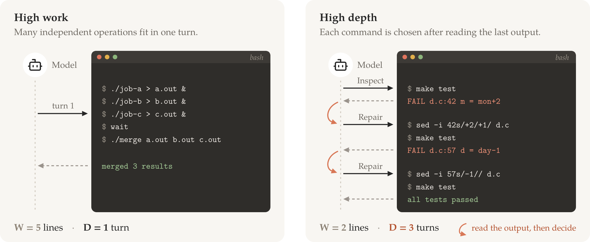
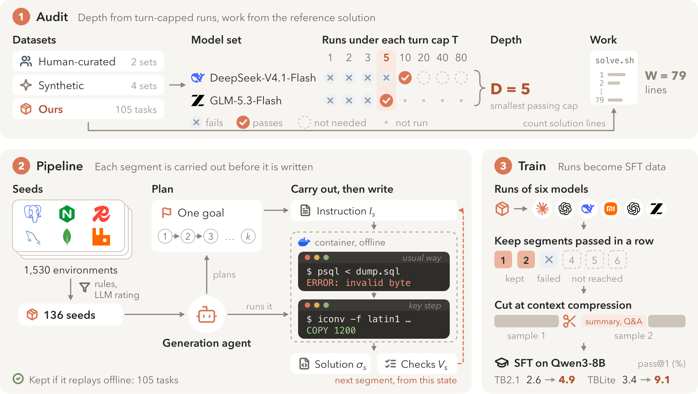
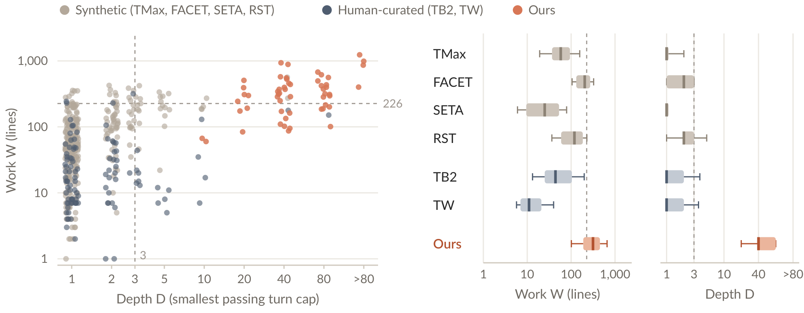

<div align="center">

# Depth

### Is Your Long-Horizon Benchmark Really Deep?<br/>Measuring and Synthesizing Depth in Terminal Tasks

[](https://arxiv.org/abs/2611.01927) [](https://huggingface.co/datasets/AlanRosston520/Depth) [](#getting-started) [](LICENSE)

**Measure the depth of terminal tasks and build tasks that require sustained interaction with real software.**

<p>
<a href="#overview">Overview</a> &nbsp;&middot;&nbsp;
<a href="#method">Method</a> &nbsp;&middot;&nbsp;
<a href="#key-findings">Key Findings</a> &nbsp;&middot;&nbsp;
<a href="#getting-started">Getting Started</a> &nbsp;&middot;&nbsp;
<a href="#citation">Citation</a>
</p>

</div>

<br/>

> [!NOTE]
> A long run does not necessarily mean a deep task. An agent may issue many commands separately even when it could batch them into one turn. **Depth** estimates how many turns a task needs by telling the agent its turn budget and finding the smallest budget under which it succeeds.

## Overview

Terminal agents are evaluated and trained on increasingly long tasks. But the number of turns an agent takes reflects both the task and the agent's habits. We distinguish **work**, the amount of operations a task requires, from **depth**, the rounds of interaction needed to act on feedback from the environment.

<!-- Paper figure: figures/v2/concept.pdf in the Overleaf source. -->
<div align="center">

<br/>
<sub><b>Work and depth capture different demands.</b> Many independent operations can be batched into one turn; choosing the next action after reading an unexpected result requires further interaction.</sub>
</div>

<br/>

The paper makes three contributions:

1. **Measure and audit.** Estimate depth with stated turn caps and audit **734 tasks from six existing datasets**.
2. **Construct deep tasks.** Build **105 tasks** segment by segment in real software environments, with later segments using the state left by earlier ones.
3. **Evaluate and train.** Evaluate six models and use their runs to fine-tune Qwen3-8B, improving performance on two terminal benchmarks.

This repository provides the **depth measurement code and multi-segment evaluation harness**. The [dataset](https://huggingface.co/datasets/AlanRosston520/Depth) is hosted separately; the [paper](https://arxiv.org/abs/2611.01927) describes task generation and fine-tuning.

---

## Method

### Measuring work and depth

| Quantity | What it captures | How it is measured |
|:--|:--|:--|
| **Work $W$** | How much a task requires doing | Non-blank, non-comment lines of the reference solution, summed over segments |
| **Depth $D$** | How many turns are needed under an explicit budget | Smallest passing turn cap under the measurement model set |
| **Turn count $N$** | How many turns the reference model actually takes | Fewest turns among its passing runs without a stated cap |

A **turn** is one model reply containing a batch of commands, followed by terminal output. We try caps `{1, 2, 3, 5, 10, 20, 40, 80}` and take the smallest depth estimate across the measurement models. $D$ is an empirical estimate: it depends on the models, the harness, and the task environment.

### Building tasks from real environments

A generation agent explores a software environment and carries out each segment before writing its reference solution and checks. The next segment starts from the state it leaves. Replaying the reference solutions in a fresh offline container must pass every segment.

<!-- Paper figure: figures/v2/overview.pdf in the Overleaf source. -->
<div align="center">

<br/>
<sub><b>Overview of the research workflow.</b> Audit measures depth and work; the generation pipeline builds and verifies dependent segments; passing segments of model runs become training data. The cap outcomes and commands shown are illustrative.</sub>
</div>

---

## Key Findings

| Finding | Result reported in the paper |
|:--|:--|
| **Existing synthetic tasks are mostly shallow** | 278 of 296 solved synthetic tasks (**94%**) pass within three turns |
| **Depth captures more than work** | Controlling for work, depth correlates with lower public pass rates on the audited human-curated tasks (rank partial correlation **−0.31**) |
| **Our tasks require sustained interaction** | Of 54 solved tasks, **44 have $D\ge40$**; median depth is **40**, and median work is **315 lines** |
| **The benchmark separates models** | The six evaluated models achieve **17–47% pass@1** |

Depth and work statistics are computed over solved tasks. In the audit protocol, a task is solved if DeepSeek-V4.1-Flash passes at least one of two runs without a stated cap.

<!-- Paper figure: figures/v2/dw.pdf in the Overleaf source. -->
<div align="center">

<br/>
<sub><b>Depth and work across datasets.</b> Each dot is a solved task. Grey denotes existing synthetic datasets, slate denotes human-curated datasets, and orange denotes ours. Dashed lines mark the 90th percentiles of the existing synthetic tasks; &gt;80 means passed only without a stated cap.</sub>
</div>

<br/>

Fine-tuning Qwen3-8B on runs from these tasks raises pass@1 from **2.6% to 4.9%** on Terminal-Bench 2.1 and from **3.4% to 9.1%** on OpenThoughts-TBLite. See the [paper](https://arxiv.org/abs/2611.01927) for the full evaluation and ablations.

---

## Getting Started

### Installation

Use **Linux**, **Docker with BuildKit**, and **Python 3.10+**. Install [uv](https://docs.astral.sh/uv/getting-started/installation/) to manage Harbor.

```bash
git clone https://github.com/AlanRosston/Depth.git
cd Depth

python3 -m venv .venv
source .venv/bin/activate
python -m pip install requests PyYAML

uv tool install harbor==0.23.0
```

Apply the bundled Harbor patch, which fixes the failure path when sending long commands to tmux:

```bash
HARBOR_SITE=$(~/.local/share/uv/tools/harbor/bin/python -c 'import harbor, os; print(os.path.dirname(os.path.dirname(harbor.__file__)))')
patch -p1 -d "$HARBOR_SITE" < patches/harbor-0.23.0-tmux_session.patch
```

Build the static tmux fallback used for task images whose package sources are offline:

```bash
docker build -t hd/tmux-static -f depth/tools/tmux-static.Dockerfile depth/tools
```

### Configuration

```bash
export OPENROUTER_API_KEY="your-openrouter-key"
```

| Variable | Purpose | Default |
|:--|:--|:--|
| `OPENROUTER_API_KEY` | Credentials for model calls | Required |
| `DEPTH_HARBOR` | Harbor executable | `~/.local/bin/harbor` |
| `DEPTH_OUT` | Result directory | `out/` in this repository |
| `DEPTH_WORKERS` | Concurrent Harbor trials | `3` |

The measurement models are **DeepSeek-V4.1-Flash** and **GLM-5.3-Flash**, configured in [`depth/protocol.py`](depth/protocol.py). Their providers are pinned in [`depth/solvers.py`](depth/solvers.py), with fallbacks disabled.

### Quick start: multi-segment tasks

Obtain the task packages from the [Depth dataset](https://huggingface.co/datasets/AlanRosston520/Depth) and place the extracted Harbor task directories under `tasks/depth/`. Each task must have a `task.toml` with `[[steps]]` entries and the corresponding segment files. Task packages and their Docker environments are required separately from this code repository.

Run these commands from the repository root; `tasks/depth/*` should expand to task directories:

```bash
# Check that the reference solutions pass every segment and doing nothing fails.
python scripts/harness.py check tasks/depth/*

# Collect two runs per task without a stated turn cap.
python scripts/harness.py free tasks/depth/*

# Measure depth under the model set, then summarize N, D, and W.
python scripts/harness.py ladder tasks/depth/*
python scripts/harness.py report
```

Segments are delivered one at a time in **one conversation and one container**. The turn cap covers the whole task; each segment has a 30-minute agent time limit, and a run stops at the first failed segment.

### Audit existing tasks

For single-instruction Harbor tasks, group task directories by dataset, for example `tasks/tb2/<task-id>/`:

```bash
python scripts/audit.py free tasks/tb2/*
python scripts/audit.py ladder tasks/tb2/*
python scripts/audit.py report
```

The agent is told the turn cap in its instruction and has a 30-minute time limit per task.

### Results

Results go to `out/` or `$DEPTH_OUT`. Completed measured runs are reused when commands are rerun.

| Output | Contents |
|:--|:--|
| `out/harness/runs/summary.json` | Multi-segment task summaries: segment count, $W$, $N$, $D$, and model estimates |
| `out/audit/runs/summary.json` | Existing-task summaries grouped by dataset, including $N$, $D$, and model estimates |
| `out/{harness,audit}/runs/<model>/results.jsonl` | Per-run records for the first measurement model |
| `out/{harness,audit}/runs/<model>__below/results.jsonl` | Later-model runs under smaller caps |

Reports also show whether measurement has finished. In result files, **`D = 99` means above the largest cap (80)**; an unsolved task has no depth estimate.

---

## Measurement Protocol

The protocol is implemented in [`depth/protocol.py`](depth/protocol.py) and [`depth/ladder.py`](depth/ladder.py).

1. **Establish solvability.** The first model runs each task twice without a stated cap. If neither run passes, the task gives no depth estimate. Otherwise, $N$ is the fewest turns among passing runs.
2. **Find the first model's estimate.** Try caps below $N$ in increasing order, with up to two runs per cap. Skip the second run if the first passes, and stop at the first passing cap. Caps at or above $N$ count as passed without additional runs.
3. **Refine with later models.** Each later model tries only caps below the smallest estimate so far, using the same retry rule, without running the task without a cap.
4. **Report depth.** $D$ is the smallest estimate across models. A task passed only above the largest cap is reported as $D>80$.

`MODELS[0]` must equal `MODEL`, the model used for the initial runs. Runs described as “without a cap” have no stated measurement budget but retain a **150-turn safety ceiling**.

<details>
<summary><b>Additional evaluation and budget controls</b></summary>

<br/>

Evaluate a registered model and report its pass rate:

```bash
python scripts/harness.py free tasks/depth/* --model openrouter/z-ai/glm-5.3-flash
python scripts/harness.py report --model openrouter/z-ai/glm-5.3-flash
```

Models must be registered in [`depth/solvers.py`](depth/solvers.py). Both `free` and `ladder` support `--max-cost`, `--reserve`, and `--stop-file` to stop starting new runs when a budget condition is met:

```bash
python scripts/harness.py free tasks/depth/* --max-cost 10
python scripts/audit.py ladder tasks/tb2/* --reserve 5
```

</details>

<details>
<summary><b>Repository layout</b></summary>

<br/>

| Path | Contents |
|:--|:--|
| [`depth/protocol.py`](depth/protocol.py), [`depth/ladder.py`](depth/ladder.py) | Measurement protocol, cap order, and depth estimates |
| [`depth/solvers.py`](depth/solvers.py), [`depth/settings.py`](depth/settings.py) | Registered models and runtime settings |
| [`depth/sandbox.py`](depth/sandbox.py), [`depth/taskenv.py`](depth/taskenv.py) | Harbor trials in Docker, task copies, and images |
| [`depth/audit/`](depth/audit/) | Measuring depth on single-instruction tasks |
| [`depth/harness/`](depth/harness/) | Multi-segment agent, trials, and depth measurement |
| [`scripts/`](scripts/) | Command-line entry points |
| [`tests/`](tests/) | Self-tests without model API calls |
| [`patches/`](patches/) | Harbor compatibility patch |

</details>

<details>
<summary><b>Development checks</b></summary>

<br/>

Run the audit self-test without Docker or model API calls:

```bash
python tests/audit_selftest.py
```

For the harness self-test, provide a Docker image containing `bash`, `python3`, `tmux`, and `/app`:

```bash
SELFTEST_TOY_IMAGE=<image> python tests/harness_selftest.py
```

</details>

---

## Citation

If you use this code or dataset in your research, please cite:

```bibtex
@misc{jiang2026depth,
  title         = {Is Your Long-Horizon Benchmark Really Deep? Measuring and Synthesizing Depth in Terminal Tasks},
  author        = {Yu Jiang and Yue Huang and Hang Hua and Yuyang Wu and Zixuan Weng and Olexandr Isayev and Yue Zhao and Zinan Lin and Xiangliang Zhang},
  year          = {2026},
  eprint        = {2611.01927},
  archivePrefix = {arXiv},
  primaryClass  = {cs.AI},
  url           = {https://arxiv.org/abs/2611.01927},
}
```

## License

Apache License 2.0 — see [LICENSE](LICENSE). The bundled [Harbor patch](patches/harbor-0.23.0-tmux_session.patch) modifies Harbor 0.23.0, which is also distributed under the Apache License 2.0.
